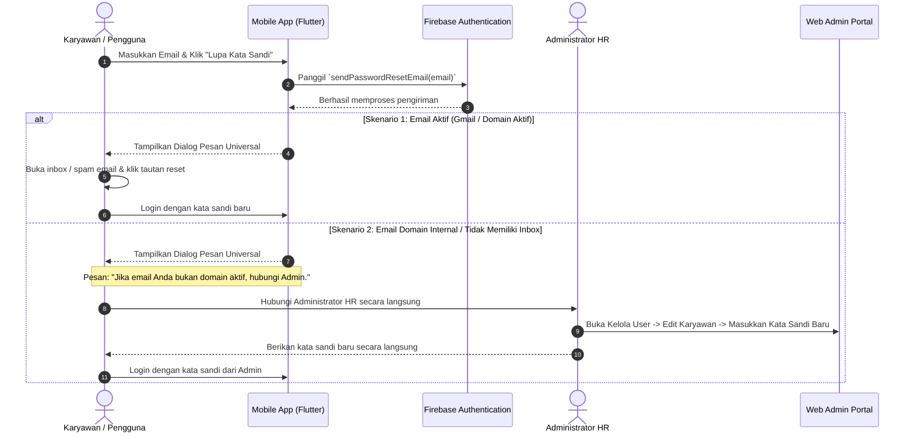

# Implementation Plan: Alur Hibrida & Pesan Universal Lupa Kata Sandi

- Status: APPROVED (Diselaraskan sesuai kesepakatan alur hibrida)
- Tanggal Diperbarui: 15 Oktober 2026
- Branch Terkait: `feat/workforce-service-workflows`

---

## 1. Latar Belakang & Analisis Kondisi Akun

Pada aplikasi presensi PT Kuda Prima, terdapat 2 kategori domain email yang digunakan oleh karyawan:

1. **Email Domain Aktif / Pribadi (misal `@gmail.com` atau korporat aktif lainnya)**:
   - Memiliki server email (inbox) penerima yang aktif.
   - Pengguna dapat menerima email masuk dan membuka link pengaturan ulang kata sandi resmi dari Firebase Authentication secara mandiri.
2. **Email Domain Internal / Tertutup (misal `@kudaprima.id` tanpa server mailbox publik)**:
   - Akun dibuat oleh Administrator melalui portal web admin.
   - Domain tersebut tidak terhubung ke inbox server publik sehingga pengiriman email oleh sistem tidak akan pernah sampai ke pengguna.
   - Pengguna pada kategori ini membutuhkan bantuan langsung dari Administrator untuk mereset kata sandi.

---

## 2. Alur Hibrida yang Disepakati

Sistem menerapkan **Alur Hibrida Universal** yang sederhana, transparan, dan tidak memerlukan integrasi pihak ketiga (seperti WhatsApp API/tautan eksternal):

### Karakteristik Utama Alur Ini:
1. **Sistem Tetap Mengirim Email ke Semua Domain**:
   - Pemanggilan `sendPasswordResetEmail(email)` tetap dijalankan untuk domain apapun (baik Gmail, partner korporat, maupun domain internal).
   - Dengan begitu, akun-akun dengan email aktif tetap terlayani secara mandiri tanpa membebani Admin.
2. **Pesan Universal Singkat, Jelas, dan Tepat**:
   - Tidak lagi hanya sekadar SnackBar samar, melainkan dialog atau pemberitahuan yang terstruktur jelas.
   - Memuat 2 informasi penting:
     - Instruksi memeriksa kotak masuk (*inbox*) atau folder *spam* email.
     - Instruksi klausul cadangan: jika akun menggunakan domain internal/tidak aktif menerima email, silakan hubungi Administrator HR / Kantor secara langsung.
3. **Tanpa Ketergantungan Eksternal (No WhatsApp Link/API)**:
   - Tidak memerlukan tombol tautan WhatsApp (`wa.me`), konfigurasi nomor HP admin, maupun antrean tiket database baru.
   - Menjaga aplikasi tetap ringan, andal, dan fokus pada alur kerja internal perusahaan.
4. **Pemberdayaan Fitur Web Admin yang Sudah Ada**:
   - Administrator HR menggunakan menu **Kelola User** (`EmployeesPage.tsx` -> modal Edit Karyawan) yang sudah mendukung pembaruan kata sandi secara aman dan langsung tersinkronisasi ke Firebase Auth.

---

## 3. Rincian Teknis Implementasi

### A. Tampilan Mobile (`login_page.dart`)

Mengganti fungsi `_resetPassword` dan SnackBar lama dengan dialog konfirmasi yang elegan:

#### 1. Validasi Input
* Memastikan pengguna telah mengisi field Email dengan format yang valid sebelum memproses.
* Jika kosong, tampilkan pesan: *"Masukkan email Anda terlebih dahulu untuk mengatur ulang kata sandi."*

#### 2. Eksekusi Pengiriman
* Memanggil `authRepository.sendPasswordResetEmail(email)`.

#### 3. Tampilan Pesan Universal (Dialog / Bottom Sheet Ringkas)
Menampilkan dialog informasi dengan teks yang singkat, jelas, dan tepat:

> **Pengaturan Ulang Kata Sandi**
> 
> Petunjuk reset kata sandi telah dikirim ke **[email pengguna]**. Silakan periksa kotak masuk (*inbox*) atau folder *spam* email Anda.
> 
> *Catatan: Jika akun Anda menggunakan email internal yang tidak memiliki kotak masuk aktif, silakan hubungi Administrator HR untuk bantuan pengaturan ulang kata sandi.*

* Tombol: **"Mengerti"** (menutup dialog).

---

### B. Tampilan Web Admin (`LoginPage.tsx`)

Jika ada pengguna admin web yang membutuhkan reset kata sandi, pesan serupa yang konsisten diterapkan pada modal lupa kata sandi admin (atau admin cukup mengandalkan akun admin lain melalui prinsip cross-approval).

---

## 4. Keuntungan Alur Ini

1. **Sederhana & Tanpa Kode Berlebih (*Zero Bloat*)**:
   - Tidak perlu membuat Cloud Functions baru (`requestPasswordReset`, `executePasswordReset`).
   - Tidak perlu koleksi Firestore baru (`passwordResetRequests`).
   - Tidak memerlukan dependensi perpesanan eksternal.
2. **Cakupan Universal**:
   - Akun Google / Gmail / email publik terlayani secara otomatis 100%.
   - Akun domain internal terarah dengan jelas ke Administrator tanpa menimbulkan kebingungan.
3. **Sesuai Tata Kelola Keamanan**:
   - Tetap mematuhi aturan keamanan Firebase Authentication dan hak akses peran Admin.

---

## 5. Rencana Pengujian Otomatis

1. **Unit & Widget Test Mobile (`login_page_test.dart`)**:
   - Pengujian pemanggilan `sendPasswordResetEmail` saat email valid dimasukkan.
   - Pengujian munculnya dialog pesan universal dan teks instruksinya.
   - Pengujian penanganan error jika email tidak terdaftar atau koneksi terputus.
2. **Quality Gates Monorepo**:
   - Menjalankan `dart format`, `flutter analyze`, dan `flutter test`.
   - Menjalankan `pnpm check` dan `pnpm build` untuk memastikan konsistensi seluruh aplikasi.
